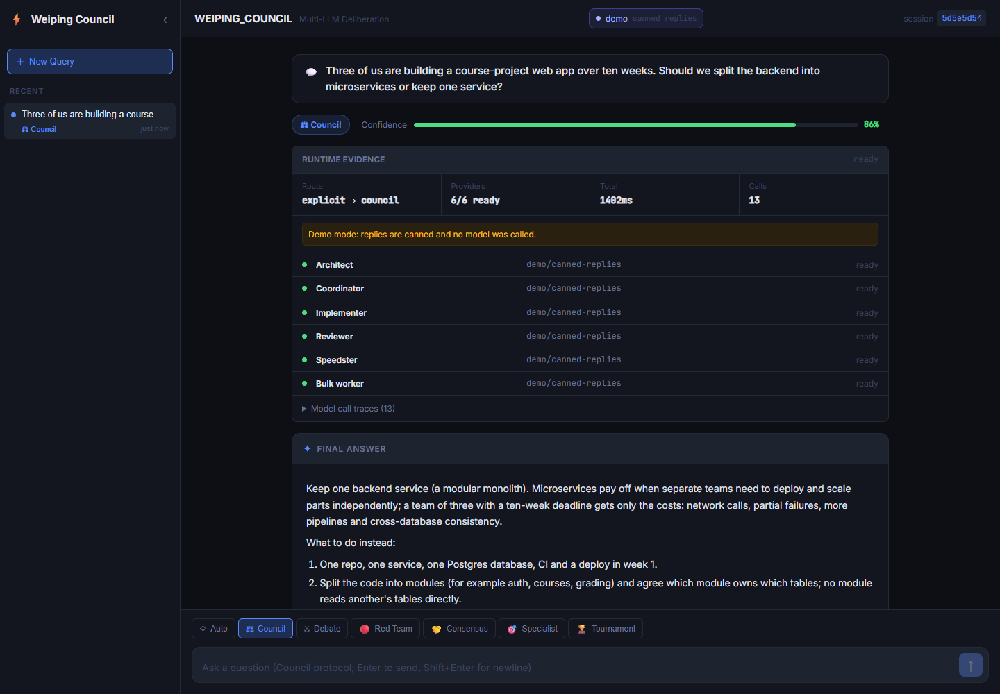

# WEIPING_COUNCIL

A local web app and CLI that sends one question to several LLMs, has them review each
other's answers anonymously, and returns a chairman's synthesis together with the
dissent and a trace of every model call.

The council protocol (first opinions, anonymized peer review, chairman synthesis) is
Andrej Karpathy's **[llm-council](https://github.com/karpathy/llm-council)** idea. I
rebuilt it with FastAPI and React and added five other protocols, a terminal client, a
demo mode and an eval script. No llm-council code is included.



*Captured with `vc serve --demo`: the replies are canned (hand-written in
[`backend/demo.py`](backend/demo.py)), while the protocol run, the 13 traced calls and
the saved session are produced by the real code. The stages view is in
[docs/screenshot-stages.png](docs/screenshot-stages.png).*

## Quickstart

Needs Python 3.11+ and, to build the web UI, Node.js 22.18+.

```bash
git clone https://github.com/appleweiping/WEIPING_COUNCIL.git
cd WEIPING_COUNCIL
python -m venv .venv
source .venv/bin/activate          # Windows: .venv\Scripts\activate
pip install -e .
cd frontend
npm ci
npm run build                      # builds the UI into frontend/dist
cd ..
vc serve --demo                    # open http://127.0.0.1:8000, no API key needed
```

For real answers, add a key and drop `--demo`:

```bash
cp .env.example .env               # Windows: copy .env.example .env
# edit .env: OPENROUTER_API_KEY=...  (any OpenAI-compatible endpoint works
#            through OPENROUTER_BASE_URL, Anthropic's API through *_FORMAT=anthropic)
vc serve
```

The same runs work from the terminal, no server needed:

```bash
vc "Should our three-person team use microservices?"       # council protocol
vc "Is a PhD worth it for an EDA career?" -p debate -v     # -v prints every stage
vc                                                         # interactive REPL
vc sessions          # recent runs; `vc show <id>` replays one
```

## Protocols

| Protocol | What happens | Calls (6 members) |
| --- | --- | --- |
| `council` | all answer, each ranks the others anonymously, the chairman synthesizes | 13 |
| `debate` | one argues for, one against, both rebut, a judge decides | 5 |
| `redteam` | five answer, the reviewer attacks them, two answers are revised | 8 |
| `consensus` | rounds of revision until enough members agree (at most 5 rounds) | 7 to 31 |
| `specialist` | the chairman picks the best-suited member, two others verify its answer | 4 |
| `tournament` | all answer, then knockout matches judged by the chairman | 11 |
| `auto` | a heuristic (plus one cheap classification call when unsure) picks one member, a decomposition, or the full council | 1 to 13+ |

Named protocols always run as chosen; only `auto` routes. A result with confidence
below 0.85 also gets up to three self-refine rounds (a critic call and a rewrite each),
recorded as an extra stage, so the counts above can grow by up to 6.

## What a run records

Every query is saved to `data/sessions/<id>.json` and shown in the UI:

- `stages`: each member's text per stage, the peer reviews, verdicts;
- `final_answer`, `confidence` and `dissent` parsed from the chairman;
- `routing`: requested vs. executed protocol and why;
- `model_call_traces`: per call the role, model id, attempts, latency and error class;
- `degraded` and `warnings`: set when a provider was missing or a call failed, so a
  partial answer is never shown as a clean one.

Keys and base URLs never appear in health output or session files.

## Members and models

There are six roles: architect (also the chairman), coordinator, implementer, reviewer,
speedster and bulk worker. Each gets a short role prompt in
[`backend/providers/router.py`](backend/providers/router.py). Out of the box five roles
use `openai/gpt-5.5` through OpenRouter and the bulk worker uses
`deepseek/deepseek-chat`, so the default council is mostly one model with different
role prompts. For a council of genuinely different models, set a model per role:

```bash
# in .env; any model ids your OpenRouter account can use
VC_PROVIDER_ARCHITECT_MODEL=anthropic/claude-opus-4.1
VC_PROVIDER_REVIEWER_MODEL=google/gemini-2.5-pro
VC_PROVIDER_SPEEDSTER_MODEL=openai/gpt-4o-mini
```

Each role can also have its own `_BASE_URL`, `_API_KEY` and `_FORMAT`; see
[docs/development.md](docs/development.md#providers).

## Does a council actually help?

I don't know yet for this code, and I am not publishing a number I have not measured.
[`eval/run_eval.py`](eval/run_eval.py) is set up to find out on grade-school math:

```bash
python eval/run_eval.py --n 20 --protocols council,debate
```

It pulls GSM8K test problems from the Hugging Face datasets server, asks one member
(`--single-role architect`) and each protocol for the answer, and prints accuracy,
calls per question and seconds per question; the per-question rows go to
`eval/results/`. Budget for it: council costs 13 to 19 calls per question, so 20
questions is a few hundred calls. `python eval/run_eval.py --demo --data q.jsonl` runs
the harness offline on your own `{"question", "answer"}` lines.

## Why not just...

- **llm-council itself?** It is the cleaner reference for the council protocol alone.
  It has no license file, no other protocols, no CLI and no per-call traces.
- **One strong model?** Often that is enough, and the eval above is how to check;
  a council costs 5 to 20 times more calls.
- **LangGraph or AutoGen?** Those are frameworks for building multi-agent systems.
  This is one small, finished app built around a few fixed protocols.

## API

`vc serve` exposes the REST API next to the UI (interactive docs at `/docs`):

```bash
curl -s http://127.0.0.1:8000/api/query -H "Content-Type: application/json" \
  -d '{"query": "Monolith or microservices for a class project?", "protocol": "council"}'
```

Other endpoints: `GET /api/health` (providers and warnings), `/api/ready` (503 when
degraded), `/api/live`, `/api/models`, `/api/protocols`, `/api/sessions`,
`/api/sessions/{id}`.

## Optional: agentmemory recall

If you run an [agentmemory](https://github.com/rohitg00/agentmemory) server, set
`AGENTMEMORY_URL` and recalled notes are passed to the models as untrusted background
text. It is off unless configured.

## Development

```bash
pip install -e ".[dev]"
python -m pytest -q && python -m ruff check .
cd frontend && npm test
```

Hot-reload setup, the provider and retry rules, the session file format and a
troubleshooting table are in [docs/development.md](docs/development.md).

## License

MIT, see [LICENSE](LICENSE).
